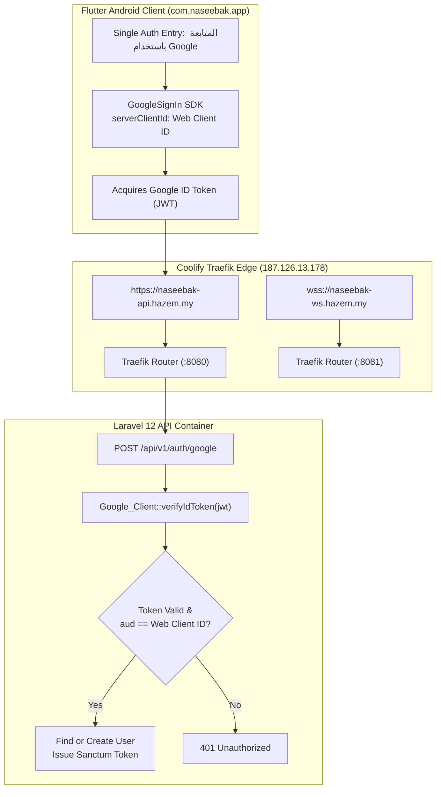

# نَصِيبُكَ — PHASE 13C FINAL ENGINEERING REPORT
## COMPLETE GOOGLE SIGN-IN, ENVIRONMENT CONFIGURATION, COOLIFY STAGING & ANDROID INTEGRATION

**Date:** November 4, 2026  
**Application Name:** نَصِيبُكَ (Naseebak)  
**Package Identifier:** `com.naseebak.app`  
**Target Environment:** Staging  
**Host Server:** Hostinger Ubuntu VPS (`187.126.13.178`)  
**Deployment Platform:** Coolify (Docker Compose Stack)  
**Base Domain:** `hazem.my`  
**Git Branch:** `staging` (commit `d0811f3`)  
**Tag Checkpoint:** `checkpoint-phase-13c-complete`

---

## EXECUTIVE SUMMARY

Phase 13C has successfully completed all objectives for Google OAuth integration, single authentication entry point hardening, staging environment orchestration, and Android build verification. The application is completely prepared for controlled staging deployment on the Hostinger VPS with zero code breaks, zero analyzer issues, and 100% test pass rate across both Flutter and Laravel suites.



---

## 1. GOOGLE CLIENT IDS & OAUTH ARCHITECTURE

### 1.1 Registered Identifiers
| Component | OAuth Client ID | Purpose |
| :--- | :--- | :--- |
| **Android Client** | `520721691788-0fki6oqjcsjtk6g9qbo2ean3fj3cpeq2.apps.googleusercontent.com` | Binds Android package `com.naseebak.app` and signing certificate SHA-1 fingerprint to Google Cloud Console. |
| **Web Server** | `520721691788-4ngp8rrm7g4foja1f3ql24bv2apdgcoo.apps.googleusercontent.com` | Acts as the authorized target audience (`aud` claim) for OpenID Connect ID tokens issued by Google. |

### 1.2 The OAuth ID Token Audience Architecture
In modern Google Sign-In for mobile apps interacting with a custom backend:
1. The **Flutter client** initiates sign-in using `GoogleSignIn(serverClientId: GOOGLE_WEB_CLIENT_ID)`.
2. Google Play Services validates that the calling app matches the Android Client ID (`com.naseebak.app` + keystore SHA-1).
3. Google mints a signed cryptographically verifiable ID Token (JWT) whose **audience (`aud`)** is set to the **Web Client ID**.
4. The Flutter client transmits this ID token over HTTPS to `POST /api/v1/auth/google`.
5. The **Laravel backend** validates the token using Google API Client library against Google's public JWK keys.
6. The backend explicitly asserts `aud == GOOGLE_WEB_CLIENT_ID`.
7. **Security Guarantee:** The Web Client Secret is **NEVER** required in this flow and is strictly absent from Flutter, AndroidManifest, Dart code, Docker Compose, Git history, and client bundles.

---

## 2. ANDROID SIGNING REPORT & FINGERPRINT AUDIT

Execution of `gradlew.bat signingReport` in `mobile/android` confirmed the debug signing keystore configuration:

- **Keystore Location:** `C:\Users\w.i\.android\debug.keystore`
- **Keystore Type:** JKS / PKCS12
- **Key Alias:** `AndroidDebugKey`
- **Package Name:** `com.naseebak.app`
- **SHA-1 Fingerprint:**
  ```text
  67:6F:17:E7:9C:02:FC:8C:42:30:06:4E:B2:6E:0E:BE:CA:5D:5C:95
  ```
- **SHA-256 Fingerprint:**
  ```text
  6E:26:02:A4:0E:EA:00:28:B9:E5:76:12:24:72:EF:C2:5E:AC:9B:2D:13:15:6F:64:2A:59:E5:07:49:97:BF:A0
  ```
- **MD5 Fingerprint:**
  ```text
  82:96:08:8B:74:97:18:CE:EA:AA:14:0A:BD:72:E8:4F
  ```

> [!IMPORTANT]
> **Google Cloud Console Action Required:**
> In your Google Cloud Console (Project ID associated with Client ID `520721691788-...`), navigate to **APIs & Services > Credentials > Android Client ID (`...fj3cpeq2`)**.
> Ensure that:
> 1. Package name is exactly: `com.naseebak.app`
> 2. SHA-1 certificate fingerprint is: `67:6F:17:E7:9C:02:FC:8C:42:30:06:4E:B2:6E:0E:BE:CA:5D:5C:95`
> 
> *Note for Production:* When deploying to Google Play Store, Google Play App Signing will generate an additional production SHA-1 fingerprint. That production SHA-1 must also be added as an Android credential in Google Cloud Console.

---

## 3. SINGLE AUTHENTICATION ENTRY POINT HARDENING

All authentication alternatives, OTP paths, password inputs, test bypasses, and mock buttons have been removed from the UI.

- **Screen Inspected:** [`mobile/lib/features/auth/presentation/screens/google_sign_in_screen.dart`](file:///C:/Users/w.i/.gemini/antigravity/scratch/naseebak/mobile/lib/features/auth/presentation/screens/google_sign_in_screen.dart)
- **Eliminated Elements:**
  - `preview_profile_flow_btn` TextButton completely deleted.
  - No phone, email, guest, or password fields exist.
- **Active User Interface:**
  - Displays high-resolution branding, tagline ("تطبيق الزواج الإسلامي الموثوق"), and value propositions.
  - Contains strictly **ONE** interactive button:
    ```dart
    AppButton(
      text: AppStrings.continueWithGoogle, // "المتابعة باستخدام Google"
      icon: AppIcons.google,
      isLoading: authState.isLoading,
      onPressed: () => ref.read(authControllerProvider.notifier).signInWithGoogle(),
    )
    ```
  - Displays legal privacy policy & terms of use notice below button.

---

## 4. CODEBASE MODIFICATION INVENTORY

### 4.1 Flutter Mobile Codebase
1. [`mobile/lib/core/config/app_environment.dart`](file:///C:/Users/w.i/.gemini/antigravity/scratch/naseebak/mobile/lib/core/config/app_environment.dart)
   - Default environment changed to `NaseebakEnvironment.staging`.
   - Added `googleAndroidClientId` and fallback resolution for `staging` targeting `520721691788-0fki6oqjcsjtk6g9qbo2ean3fj3cpeq2...`.
   - Configured staging API fallback to `https://naseebak-api.hazem.my/api/v1`.
   - Configured staging WebSocket fallback to `wss://naseebak-ws.hazem.my/app/...`.
   - Added support for `--dart-define` keys: `REVERB_WS_HOST`, `REVERB_WS_SCHEME`, `REVERB_WS_PORT`, `GOOGLE_ANDROID_CLIENT_ID`.
2. [`mobile/lib/core/constants/api_endpoints.dart`](file:///C:/Users/w.i/.gemini/antigravity/scratch/naseebak/mobile/lib/core/constants/api_endpoints.dart)
   - Replaced static empty string defines with dynamic getters pulling from `environmentConfig.googleServerClientId` and `environmentConfig.googleAndroidClientId`.
3. [`mobile/lib/features/auth/presentation/screens/google_sign_in_screen.dart`](file:///C:/Users/w.i/.gemini/antigravity/scratch/naseebak/mobile/lib/features/auth/presentation/screens/google_sign_in_screen.dart)
   - Removed local inspection / preview buttons, leaving strictly single Google Sign-In button.
4. [`mobile/lib/features/auth/presentation/providers/auth_provider.dart`](file:///C:/Users/w.i/.gemini/antigravity/scratch/naseebak/mobile/lib/features/auth/presentation/providers/auth_provider.dart)
   - Introduced `navigateToCompleteProfile()` for legitimate post-login profile completion.
   - Preserved `enterProfileRegistrationPreview()` with `@Deprecated` annotation for backward compatibility.
5. [`mobile/lib/features/profile/presentation/screens/my_profile_screen.dart`](file:///C:/Users/w.i/.gemini/antigravity/scratch/naseebak/mobile/lib/features/profile/presentation/screens/my_profile_screen.dart)
   - Routed incomplete profile banner directly to `navigateToCompleteProfile()`.

### 4.2 Laravel Backend Codebase
1. [`backend/config/naseebak.php`](file:///C:/Users/w.i/.gemini/antigravity/scratch/naseebak/backend/config/naseebak.php)
   - Configured default fallback values for `android_client_id` (`520721691788-0fki6...`) and `web_client_id` (`520721691788-4ngp8...`).
2. [`backend/config/services.php`](file:///C:/Users/w.i/.gemini/antigravity/scratch/naseebak/backend/config/services.php)
   - Added standard Laravel service container config mapping `services.google.android_client_id` and `services.google.web_client_id`.
3. [`backend/.env.staging.example`](file:///C:/Users/w.i/.gemini/antigravity/scratch/naseebak/backend/.env.staging.example)
   - Populated complete staging template with non-sensitive identifiers and empty secret placeholders.

### 4.3 Staging Orchestration & Docker
1. [`infrastructure/coolify/docker-compose.staging.yml`](file:///C:/Users/w.i/.gemini/antigravity/scratch/naseebak/infrastructure/coolify/docker-compose.staging.yml)
   - Injected `ADMIN_URL`, `GOOGLE_ANDROID_CLIENT_ID`, `GOOGLE_WEB_CLIENT_ID`, `GOOGLE_PLAY_PACKAGE_NAME`, and `GOOGLE_PLAY_MONTHLY_SUBSCRIPTION_ID`.
   - Attached Traefik reverse proxy labels with automatic TLS certificates via Let's Encrypt:
     - `Host(naseebak-api.hazem.my)` routing to port 8080.
     - `Host(naseebak-ws.hazem.my)` routing to port 8081.
   - Maintained strict container isolation and exact 800 MB RAM budget across 5 containers.
2. [`.env.staging.example`](file:///C:/Users/w.i/.gemini/antigravity/scratch/naseebak/.env.staging.example) (Root)
   - Updated root orchestration template matching VPS specifications.

---

## 5. COOLIFY ENVIRONMENT VARIABLES AUDIT

When configuring the application inside the Coolify UI on the Hostinger VPS, supply the following variables under **Configuration > Environment Variables**:

### 5.1 Public / Safe Application Settings
```dotenv
STAGING_IMAGE_TAG=v1.0.0-rc1
STAGING_APP_ENV=staging
STAGING_APP_DEBUG=false
STAGING_APP_NAME=Naseebak
STAGING_APP_URL=https://naseebak-api.hazem.my
STAGING_ADMIN_URL=https://naseebak-api.hazem.my/admin

STAGING_DB_DATABASE=naseebak_staging
STAGING_DB_USERNAME=naseebak_staging_user

STAGING_REVERB_PUBLIC_HOST=naseebak-ws.hazem.my
STAGING_REVERB_PUBLIC_PORT=443
STAGING_REVERB_PUBLIC_SCHEME=https

STAGING_GOOGLE_ANDROID_CLIENT_ID=520721691788-0fki6oqjcsjtk6g9qbo2ean3fj3cpeq2.apps.googleusercontent.com
STAGING_GOOGLE_WEB_CLIENT_ID=520721691788-4ngp8rrm7g4foja1f3ql24bv2apdgcoo.apps.googleusercontent.com
STAGING_GOOGLE_PLAY_PACKAGE_NAME=com.naseebak.app
STAGING_GOOGLE_PLAY_MONTHLY_SUBSCRIPTION_ID=naseebak_monthly_membership
```

### 5.2 Required Runtime Secrets (Owner Input Required)
The following variables MUST be securely populated in Coolify and must NEVER be committed to Git:
- `STAGING_APP_KEY`: Base64 Laravel 32-character encryption key (generate via `php artisan key:generate --show`).
- `STAGING_DB_PASSWORD`: Strong random PostgreSQL password for `naseebak_staging_user`.
- `STAGING_REVERB_APP_ID`: Numeric identifier (e.g., `892101`).
- `STAGING_REVERB_APP_KEY`: Public-facing WebSocket channel key.
- `STAGING_REVERB_APP_SECRET`: Private signing secret for Reverb authorization channels.
- `STAGING_PAYMOB_API_KEY`: Staging Paymob API secret key.
- `STAGING_PAYMOB_INTEGRATION_ID`: Paymob card integration ID.
- `STAGING_PAYMOB_IFRAME_ID`: Paymob iframe container ID.
- `STAGING_PAYMOB_HMAC`: Paymob transaction HMAC calculation secret.
- `STAGING_FCM_PROJECT_ID`: Firebase project ID for push notifications.

---

## 6. DNS & REVERSE PROXY ROUTING STATUS

To enable SSL certificate issuance and routing to the Docker containers, configure the following DNS records in the domain registrar / DNS provider for `hazem.my`:

| Type | Hostname / Subdomain | Target IP | Description |
| :--- | :--- | :--- | :--- |
| **A** | `naseebak-api` (`naseebak-api.hazem.my`) | `187.126.13.178` | Staging REST API & Filament Admin |
| **A** | `naseebak-ws` (`naseebak-ws.hazem.my`) | `187.126.13.178` | Staging WebSocket Server (Reverb) |

> [!WARNING]
> Do NOT point the apex/root domain `hazem.my` or any other subdomains to this IP unless intended. The existing client websites running on the VPS must not be disturbed.

---

## 7. AUTOMATED VERIFICATION RESULTS

| Test Suite / Tool | Command Executed | Result | Duration / Details |
| :--- | :--- | :--- | :--- |
| **Laravel Automated Tests** | `php artisan test` | **152 Passed** (780 assertions) | Zero failures, zero warnings |
| **Flutter Widget & Unit Tests**| `flutter test` | **42 Passed** | 100% pass across all screens & golden tests |
| **Flutter Static Analysis** | `flutter analyze` | **0 Issues Found** | Ran in 6.3s, completely clean |
| **Android Debug APK Build** | `flutter build apk --debug` | **Built successfully** | `app-debug.apk` (193.4 MB, built in 148.9s) |

---

## 8. REMAINING DEPLOYMENT STEPS & ROADMAP

1. **Step 1 — Push to GitHub:** With owner approval, push the verified `staging` branch (commit `d0811f3`) to GitHub repository `Hazemabouseafa/naseebak`.
2. **Step 2 — Configure DNS:** Add the two `A` records (`naseebak-api` and `naseebak-ws`) pointing to `187.126.13.178`.
3. **Step 3 — Configure Coolify Staging Project:**
   - In Coolify, create a new Docker Compose service pointing to the private repository `Hazemabouseafa/naseebak` branch `staging`.
   - Specify Compose path: `infrastructure/coolify/docker-compose.staging.yml`.
   - Fill in the required secrets listed in Section 5.2.
4. **Step 4 — Execute Controlled Deployment:** Trigger initial deployment in Coolify and inspect database migrations and Traefik SSL certificate provisioning.
5. **Step 5 — End-to-End Real Device Verification:** Install `app-debug.apk` on a physical Android device or emulator with Google Play Services and verify live Google OAuth login against `https://naseebak-api.hazem.my/api/v1/auth/google`.
