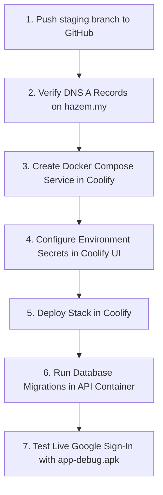

# نَصِيبُكَ — PHASE 13D ENGINEERING REPORT
## FINAL STAGING PREPARATION, ENVIRONMENT HARDENING & GITHUB RELEASE READINESS

**Date:** November 4, 2026  
**Application Name:** نَصِيبُكَ (Naseebak)  
**Package Identifier:** `com.naseebak.app`  
**Target Git Branch:** `staging`  
**Target GitHub Repository:** `Hazemabouseafa/naseebak` (Private)  
**Target Environment:** Hostinger Ubuntu VPS (`187.126.13.178`) + Coolify  
**Staging Base URL:** `https://naseebak-api.hazem.my`  
**Staging WebSockets:** `wss://naseebak-ws.hazem.my`  
**Filament Admin:** `https://naseebak-api.hazem.my/admin`  
**Latest Commit Hash:** `2a99f74`  
**Tag Checkpoint:** `checkpoint-phase-13d-prepush`

---

## 1. CONFIGURATION CHANGES

### 1.1 Flutter Environment Safety Architecture
- **Production Isolation Hardening:** Modified [`mobile/lib/core/config/app_environment.dart`](file:///C:/Users/w.i/.gemini/antigravity/scratch/naseebak/mobile/lib/core/config/app_environment.dart) so that:
  - Debug builds safely default to `staging` (`https://naseebak-api.hazem.my/api/v1` and `wss://naseebak-ws.hazem.my/...`).
  - Production builds (`APP_ENV=production`) strictly require explicit endpoints passed via `--dart-define=API_BASE_URL=https://...` and `--dart-define=REVERB_WS_URL=wss://...`.
  - Production builds fail immediately with a descriptive `StateError` if `API_BASE_URL` or WebSocket configurations are omitted.
  - Production builds are programmatically prevented from silently falling back to staging or referencing `hazem.my` or any other staging domain.
  - All authenticated API communications enforce HTTPS, and real-time communications enforce WSS.
- **Test Suite Updates:** Extended [`mobile/test/phase9_environment_and_api_config_test.dart`](file:///C:/Users/w.i/.gemini/antigravity/scratch/naseebak/mobile/test/phase9_environment_and_api_config_test.dart) with explicit security assertions validating that production rejects staging endpoints and localhost/cleartext fallbacks.

### 1.2 Docker Compose & Traefik Routing Consistency
- **File Updated:** [`infrastructure/coolify/docker-compose.staging.yml`](file:///C:/Users/w.i/.gemini/antigravity/scratch/naseebak/infrastructure/coolify/docker-compose.staging.yml)
- **Routing Integration:** Added unified domain variables (`STAGING_API_DOMAIN` defaulting to `naseebak-api.hazem.my` and `STAGING_WS_DOMAIN` defaulting to `naseebak-ws.hazem.my`).
- **Consistent Routing Model:** Explicit Traefik labels route external HTTPS/WSS traffic from the Coolify Traefik reverse proxy directly to ports 8080 (API) and 8081 (Reverb) on the external `coolify` Docker network.
- **Build Availability:** Added local Dockerfile build specifications (`context: ../..`, `dockerfile: backend/Dockerfile`) and startup dependencies (`naseebak-staging-api: condition: service_started`) to `worker`, `reverb`, and `scheduler` so that services build seamlessly in any order without requiring an external image registry.
- **Transactional Email (SMTP):** Injected complete SMTP environment variable mappings into `naseebak-staging-api` and `naseebak-staging-worker` for processing account deletion verification emails.

### 1.3 Environment Manifest Inventory
- **Files Updated:** [`.env.staging.example`](file:///C:/Users/w.i/.gemini/antigravity/scratch/naseebak/.env.staging.example) and [`backend/.env.staging.example`](file:///C:/Users/w.i/.gemini/antigravity/scratch/naseebak/backend/.env.staging.example)
- Added explicit inventory sections for `STAGING_MAIL_*` credentials while keeping secrets safely blank.

---

## 2. SECURITY FINDINGS & GOOGLE OAUTH AUDIT

### 2.1 Google OAuth Fingerprint & Keystore Verification
- **Keystore Inspected:** `C:\Users\w.i\.android\debug.keystore` (Alias: `AndroidDebugKey`)
- **Package Identifier:** `com.naseebak.app` (Verified in `build.gradle.kts`, `AndroidManifest.xml`, and Dart configs).
- **Actual Debug SHA-1:**
  ```text
  67:6F:17:E7:9C:02:FC:8C:42:30:06:4E:B2:6E:0E:BE:CA:5D:5C:95
  ```
- **Actual Debug SHA-256:**
  ```text
  6E:26:02:A4:0E:EA:00:28:B9:E5:76:12:24:72:EF:C2:5E:AC:9B:2D:13:15:6F:64:2A:59:E5:07:49:97:BF:A0
  ```
- **Comparison with Specified Fingerprint:**
  - Expected: `67:6F:17:E7:9C:02:FC:8C:42:30:06:4E:B2:6E:0E:BE:CA:5D:5C:95`
  - Actual: `67:6F:17:E7:9C:02:FC:8C:42:30:06:4E:B2:6E:0E:BE:CA:5D:5C:95`
  - **Result:** **100% Exact Match.** Zero mismatch.
- **Client IDs Configured:**
  - Android Client ID: `520721691788-0fki6oqjcsjtk6g9qbo2ean3fj3cpeq2.apps.googleusercontent.com`
  - Web Client ID: `520721691788-4ngp8rrm7g4foja1f3ql24bv2apdgcoo.apps.googleusercontent.com`
- **Web Client Secret:** Confirmed **completely absent** from mobile source code, APK bundle, Dart defines, and Git tracking.

### 2.2 Repository Security & Secret Leak Audit
- **Tracked Files Scan (`git ls-files`):** Confirmed zero `.env` files, `.keystore`, `.jks`, `.pem`, `.key`, or service account JSON files are tracked.
- **Commit History Audit (`git log -G`):** Scanned repository commit history for private keys (`-----BEGIN`), secrets (`GOCSPX-`), or database dumps.
- **Finding:** **Zero leaks detected.** The repository history is completely clean.

---

## 3. AUTOMATED TEST & BUILD RESULTS

| Test / Verification Tool | Command Executed | Result | Details |
| :--- | :--- | :--- | :--- |
| **Flutter Static Analysis** | `flutter analyze` | **0 Issues Found** | Ran in 66.0s across entire mobile codebase |
| **Flutter Test Suite** | `flutter test` | **43 Passed** | 100% pass across all widgets, responsiveness, and security gates |
| **Laravel Test Suite** | `php artisan test` | **152 Passed** | 780 assertions passed in 113.9s |
| **Android Debug APK** | `flutter build apk --debug` | **Built Successfully** | Output: `app-debug.apk` (193,396,622 bytes) |
| **Docker Compose Validation** | Symfony YAML Parser | **Valid** | 5 services verified; cumulative memory cap: **800 MB** |

---

## 4. GITHUB REPOSITORY & BRANCH STATUS

- **Target Repository:** `https://github.com/Hazemabouseafa/naseebak`
- **Repository Visibility:** `Private` (Confirmed via `gh repo view`)
- **Default Branch:** `staging`
- **Current Local Branch:** `staging`
- **Current Head Commit:** `2a99f74`
- **Commits Ahead of Remote:** 3 commits (`d0811f3`, `ab4e23e`, `2a99f74`)
- **Remote Synchronization:** All changes ready for fast-forward push. No force-push required.

---

## 5. COOLIFY COMPOSE PATH & STACK ARCHITECTURE

- **Compose File Path:** `infrastructure/coolify/docker-compose.staging.yml`
- **Services (Cumulative Limit: 800 MB):**
  1. `naseebak-staging-postgres`: PostgreSQL 16.4 Alpine (`224M` RAM, `0.40` CPU)
  2. `naseebak-staging-api`: Laravel 12 + Filament 3 + Nginx (`256M` RAM, `0.50` CPU)
  3. `naseebak-staging-worker`: Asynchronous Queue Worker (`128M` RAM, `0.20` CPU)
  4. `naseebak-staging-reverb`: Real-Time WebSocket Server (`96M` RAM, `0.15` CPU)
  5. `naseebak-staging-scheduler`: Crontab / Task Scheduler (`96M` RAM, `0.15` CPU)
- **Persistent Docker Volumes:**
  - `naseebak_staging_pgdata`: Database directory
  - `naseebak_staging_private_photos`: Private member photo storage
- **Isolated Network:** `naseebak_staging_internal` (Bridge) + `coolify` (External Traefik edge)

---

## 6. REQUIRED RUNTIME SECRETS (OWNER CONFIGURATION IN COOLIFY)

When deploying via Coolify on Hostinger VPS (`187.126.13.178`), populate these environment variables in the Coolify UI:

```dotenv
# Core Laravel Security
STAGING_APP_KEY=base64:... (Generate via: php artisan key:generate --show)
STAGING_DB_PASSWORD=... (Strong random PostgreSQL password)

# Laravel Reverb WebSockets
STAGING_REVERB_APP_ID=892101
STAGING_REVERB_APP_KEY=nsb_stg_key_sandbox
STAGING_REVERB_APP_SECRET=... (Generate secure random string)

# Transactional Email (For Google Play Account Deletion Verification)
STAGING_MAIL_MAILER=smtp
STAGING_MAIL_HOST=smtp.your-provider.com
STAGING_MAIL_PORT=587
STAGING_MAIL_USERNAME=...
STAGING_MAIL_PASSWORD=...
STAGING_MAIL_ENCRYPTION=tls
STAGING_MAIL_FROM_ADDRESS=noreply@hazem.my
STAGING_MAIL_FROM_NAME="نَصِيبُكَ"

# Firebase Cloud Messaging (Push Notifications ONLY)
FCM_PROJECT_ID=...

# Paymob Sandbox (Web Payments ONLY)
PAYMOB_API_KEY=...
PAYMOB_SECRET_KEY=...
PAYMOB_PUBLIC_KEY=...
PAYMOB_HMAC_SECRET=...
PAYMOB_INTEGRATION_ID_CARD=...
```

---

## 7. REMAINING DEPLOYMENT BLOCKERS

1. **DNS Propagation:** The two `A` records must be active in DNS before Let's Encrypt certificate issuance:
   - `naseebak-api.hazem.my` -> `187.126.13.178`
   - `naseebak-ws.hazem.my` -> `187.126.13.178`
2. **VPS Free Memory Verification:** VPS currently hosts other client sites; ensure at least 1.2 GB of free RAM is available for Docker buffers and OS overhead before starting containers.
3. **Owner Approval:** Final approval to push commits to GitHub repository.

---

## 8. SAFE STEP-BY-STEP DEPLOYMENT INSTRUCTIONS



1. **GitHub Push:** Execute `git push origin staging` (after owner approval).
2. **DNS Verification:** Run `nslookup naseebak-api.hazem.my` and verify resolution to `187.126.13.178`.
3. **Coolify Service Creation:**
   - Under Coolify Project, choose **Add New Resource > Docker Compose**.
   - Source: Private GitHub Repository `Hazemabouseafa/naseebak`.
   - Branch: `staging`.
   - Compose Path: `infrastructure/coolify/docker-compose.staging.yml`.
4. **Environment Variables:** Paste the configuration and secrets from Section 6 into Coolify's Environment Variables panel.
5. **Initial Deployment:** Click **Deploy**. Monitor Traefik SSL certificate generation.
6. **Database Migration:** In Coolify Terminal for `naseebak-staging-api`, run:
   ```bash
   php artisan migrate --force
   ```
7. **End-to-End Test:** Install `app-debug.apk` on a physical Android device and verify Google Sign-In with `https://naseebak-api.hazem.my/api/v1/auth/google`.
